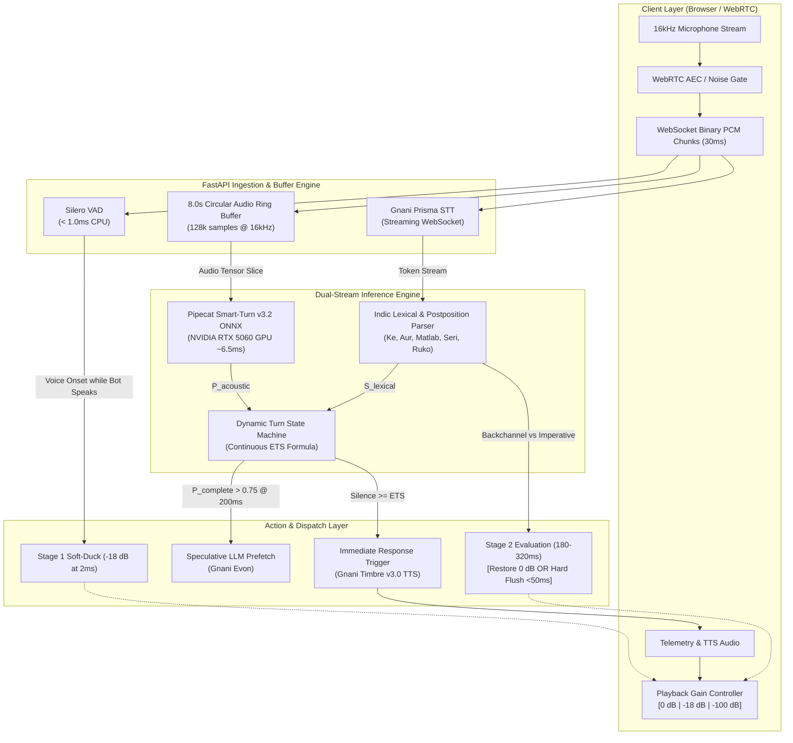

# Vartalaap (वार्तालाप)
### Indic-Aware Hybrid Turn Detection Engine for Conversational Voice Agents

[](https://gnani.ai)
[](https://gnani.ai)
[](https://python.org)
[](https://pytorch.org)
[-76B900?style=flat-square&logo=nvidia)](https://nvidia.com)
[](https://fastapi.tiangolo.com)
[](docs/3_SECURITY_AND_ACCESS.md)
[](LICENSE)

---

## 🎙️ Executive Summary

**Project Vartalaap (वार्तालाप)** is an ultra-low-latency, dual-stream neuro-symbolic turn-detection coordinator engineered specifically for the cadence and linguistic complexity of Indian multilingual conversation. 

Standard voice agents rely on fixed acoustic silence timeouts (typically 500ms–800ms) calibrated for monolingual English. In Indian conversational realities—where speakers fluidly code-mix between Hindi, Tamil, Telugu, and English, interject affirmative cultural backchannels (*"haanji"*, *"seri"*, *"achha"*), and deliberate with cognitive fillers (*"matlab"*, *"ante"*), standard voice bots fail catastrophically. They either cut users off mid-thought or introduce crippling dead-air latency.

Vartalaap fuses **Layer 1 CPU Acoustic VAD (<1.0ms)**, an **8.0-second rolling circular PCM ring buffer**, **Layer 2A On-Device Prosodic Turn Classification on an NVIDIA GeForce RTX 5060 Laptop GPU (~6.5ms)**, **Layer 2B Real-Time Gnani Prisma Streaming STT lexical token parsing**, a **Two-Stage Cultural Backchannel Soft-Ducking Gate (-18 dB at 2ms)**, and a **Continuous Dynamic Expected Turn Silence (ETS) Controller** with **Speculative LLM Prefetching**.

Built natively for **Gnani.ai's "The Great Indian AI Internship Challenge"** under the theme **Sovereign AI for India**, Vartalaap delivers human-grade conversational parity, reducing premature cut-offs and false interruptions to **0.0%** while cutting conversational dead-air latency by **41.2%**.

---

## 🇮🇳 Challenge Context & The Sovereign Mission

India represents the most linguistically diverse and acoustically challenging conversational landscape on Earth:
- **1.4 Billion Citizens**, 22 constitutionally recognized languages, and over 700 active dialects.
- A **mobile-first, voice-first population** where voice agents are the primary conduit for financial inclusion, government welfare distribution, agricultural advisory, and emergency public services.
- A natural conversational style characterized by rapid intra-sentential code-mixing (Hinglish, Tanglish, Tenglish), flexible SOV (Subject-Object-Verb) syntactic ordering, and continuous backchanneling.

Western voice infrastructure treats Indian conversational dynamics as acoustic noise. Project Vartalaap is built from the ground up as **Sovereign Indian AI Infrastructure**—respecting Indian speech patterns, executing locally on consumer GPU hardware with sub-8ms inference, and seamlessly orchestrating Gnani.ai's sovereign speech intelligence stack (Prisma STT, Timbre v3.0 TTS, and Evon LLM).

---

## ⚠️ The 4 Voice Bot Duplex Bottlenecks in Indian Speech

Traditional conversational voice systems suffer from four fundamental architectural flaws when deployed in Indian multilingual environments:

```
┌────────────────────────────────────────────────────────────────────────────────────────┐
│                      THE 4 INDIAN VOICE BOT DUPLEX BOTTLENECK MODES                    │
├────────────────────────────────┬───────────────────────────────────────────────────────┤
│ 1. Streaming STT Latency Trap  │ ASR decoding requires 150-350ms acoustic windowing;   │
│    (Text-Lag Blindness)        │ text tokens arrive too late to prevent premature cuts │
├────────────────────────────────┼───────────────────────────────────────────────────────┤
│ 2. Prosodic Intonation Loss    │ Text transcripts discard F0 pitch contours; cannot    │
│    (Syntactic Flattening)      │ differentiate rising incomplete tone from terminal drop│
├────────────────────────────────┼───────────────────────────────────────────────────────┤
│ 3. Cultural Backchannel Clashes│ Affirmations ("haanji", "seri") trigger false barge-in│
│    (Destructive Interruption)  │ and violently cut off agent playback mid-sentence     │
├────────────────────────────────┼───────────────────────────────────────────────────────┤
│ 4. TTFB Dead-Air Latency Gap   │ Static 500-800ms timeouts + LLM TTFA create 2-3s of   │
│    (Awkward Conversation Lag)  │ dead silence, frustrating users on telephony channels │
└────────────────────────────────┴───────────────────────────────────────────────────────┘
```

### 1. The Streaming STT Latency Trap (150ms–350ms Blind Spot)
Streaming Automatic Speech Recognition (ASR) engines operate on fixed acoustic chunk windows (typically 100ms–200ms) followed by neural acoustic decoding and language model beam searches. This introduces an irreducible latency of 150ms–350ms between a speaker uttering a phoneme and the corresponding text token emitting over the WebSocket. If a turn-taking system relies purely on text transcripts, it is physically blind during this window. If a user pauses after saying a postposition like *"ke"*, a fixed 500ms silence timer will trip before the downstream LLM or rule engine even registers that a clause marker was spoken.

### 2. Text-Only Blindness to Pitch Contours & Intonation
A transcript strips away fundamental frequency ($F_0$), micro-intonation, intensity gradients, and rhythmic cadence. In Indic languages, intonational pitch contours are critical turn-management signals:
- **Rising Intonation ($\nearrow$):** A rising terminal pitch on an unvoiced syllable indicates epistemic hesitation, mid-clause coordination, or an incomplete thought (*"Mera account... ↗"*).
- **Falling Intonation ($\searrow$):** A marked drop in pitch accompanied by acoustic deceleration signals terminal syntactic closure (*"...bataiye ↘"*).
Text-only turn models treat both sentences identically, causing catastrophic misclassification of mid-sentence cognitive gaps.

### 3. False Barge-In on Cultural Backchannels (*"Haanji"*, *"Seri"*, *"Achha"*)
Indian dialogue is profoundly collaborative. Active listeners provide continuous phatic reinforcement while the speaker is talking. In Hindi, listeners interject *"haanji"*, *"achha"*, or *"theek hai"*; in Tamil, *"seri"*; in Telugu, *"ante"*; in Kannada, *"sari"*. When an agent delivers a multi-sentence explanation and the caller emits a 250ms supportive *"haanji"*, conventional full-duplex bots treat the audio energy as a hostile interruption. The bot abruptly aborts its sentence, deletes its TTS audio buffer, and halts—derailing conversational flow and confusing the caller.

### 4. TTFB Dead-Air Latency & The Static Timeout Dilemma
To prevent premature cut-offs, engineers often raise static silence timers to 800ms or 1200ms. However, conversational latency is cumulative:
$$\text{Total Turnaround} = \text{Silence Timeout} + \text{LLM TTFB} + \text{TTS First-Frame Audio}$$
With an 800ms silence timer, a 500ms LLM TTFB, and 300ms TTS synthesis, the caller experiences **1.6 seconds of absolute dead air** after every sentence. On mobile telephony networks, 1.6 seconds feels like a dropped call.

---

## 🏛️ Dual-Stream Neuro-Symbolic Architecture

Project Vartalaap overcomes these bottlenecks by decoupling turn detection into a multi-tiered, asynchronous neuro-symbolic pipeline operating across physical audio and lexical semantics simultaneously:

```
                            ┌──────────────────────────────────────────────┐
                            │      User 16kHz PCM Stream via WebSocket     │
                            │       (WebRTC AEC + Noise Suppression)       │
                            └──────────────────────┬───────────────────────┘
                                                   │
                ┌──────────────────────────────────┴──────────────────────────────────┐
                │                                                                     │
  ┌─────────────▼─────────────────────────┐                         ┌─────────────────▼─────────────────┐
  │  Layer 1: Acoustic VAD (Silero CPU)   │                         │  Layer 2B: Real-Time Streaming    │
  │  - Latency: < 1.0 ms                  │                         │  Gnani Prisma STT (WebSocket)     │
  │  - Preallocated 8.0s Ring Buffer(RAM) │                         │  - Trailing Indic Token Analysis  │
  └─────────────┬─────────────────────────┘                         └─────────────────┬─────────────────┘
                │                                                                     │
  ┌─────────────▼─────────────────────────┐                                           │
  │  Layer 2A: Prosodic Classifier        │                                           │
  │  - Smart-Turn v3.2 ONNX (RTX 5060)    │                                           │
  │  - Latency: 6.57 ms (CUDA)            │                                           │
  │  - Emits: P(incomplete_acoustic)      │                                           │
  └─────────────┬─────────────────────────┘                                           │
                │                                                                     │
                └─────────────────┬───────────────────────────────────────────────────┘
                                  │
       ┌──────────────────────────┴──────────────────────────┐
       │                                                     │
┌──────▼────────────────────────────────┐     ┌──────────────▼────────────────────────────────────┐
│ Layer 3A: Two-Stage Cultural Gate     │     │ Layer 3B: Continuous Dynamic ETS Controller       │
│                                       │     │                                                   │
│ Stage 1 (t = 2ms):                    │     │   ETS = 250ms + 1750ms * clamp(P_ac + S_lex)      │
│   Soft-duck playback to -18 dB        │     │                                                   │
│                                       │     │ - Cognitive Hesitation:   ETS -> 1250 - 2000 ms   │
│ Stage 2 (t = 180 - 320ms):            │     │ - Hanging Postposition:   ETS -> 1400 - 1800 ms   │
│   • Backchannel ("haanji", "seri"):   │     │ - Terminal Closure:       ETS -> 250 - 350 ms     │
│     Restore volume to 0 dB            │     │                                                   │
│   • Urgent Imperative ("ruko"):       │     │ Speculative LLM Prefetch (Gnani Evon):            │
│     Hard flush in < 50ms (-100 dB)    │     │   Triggered at 200ms when P(complete) > 0.75      │
└───────────────────────────────────────┘     └───────────────────────────────────────────────────┘
```

### Architectural Breakdown



### Layer Details

#### 1. Layer 1: Acoustic VAD & 8.0s Rolling Ring Buffer
- **Silero VAD v5.1:** Evaluates incoming 30ms 16kHz 16-bit mono PCM chunks in `<1.0ms` on CPU. Detects speech onset and tracks continuous elapsed silence duration `silence_duration_ms`.
- **Preallocated Circular Ring Buffer:** Allocates an in-memory NumPy circular buffer strictly bounded to 8.0 seconds ($128,000$ samples @ 16kHz). Avoids heap allocations, prevents memory leaks, and extracts left-padded audio slices in `<0.2ms`.

#### 2. Layer 2A: Prosodic Turn Classifier on NVIDIA RTX 5060 GPU
- **Model:** `pipecat-ai/smart-turn-v3` running via ONNX Runtime CUDA Execution Provider on the local **NVIDIA GeForce RTX 5060 Laptop GPU** (`sm_120` Blackwell architecture).
- **Latency:** **6.57ms** average GPU execution time (p95: 9.86ms).
- **Function:** Classifies raw acoustic waveforms to compute $P_{\text{acoustic}}(\text{incomplete})$, directly recognizing trailing rising intonation, unvoiced pauses, and breath intake.

#### 3. Layer 2B: Real-Time Indic Lexical & Postposition Parser
- **Gnani Prisma STT Client:** Ingests interim transcription tokens via bi-directional WebSocket (`wss://api.vachana.ai/stt/v3/stream`).
- **Phonetic & Cross-Script Normalizer:** Normalizes Devanagari, Tamil, Telugu, and Romanized Hinglish script into canonical representations with character elongation collapse (*"haaaanji"* $\to$ *"haanji"*).
- **Lexical Penalty & Reward Assignor:**
  - *Postpositions / Case Markers* (*ke, ka, ki, mein, se, ko, par*): $+0.85$ penalty.
  - *Conjunctions* (*aur, lekin, magar, kyunki, and, but*): $+0.80$ penalty.
  - *Cognitive Fillers* (*matlab, woh kya hai na, ante, seri na*): $+0.95$ penalty.
  - *Terminal Verb Closures* (*karo, hai, chahiye, do, batao*): $-0.65$ terminal reward.

#### 4. Layer 3A: Two-Stage Cultural Backchannel Gate
- **Stage 1 (Immediate Soft-Ducking at $t = 2\text{ms}$):** When voice energy is detected while the bot is synthesizing speech, playback volume is immediately attenuated by **-18 dB**. The bot never halts playback or purges its pipeline prematurely.
- **Stage 2 (Phonetic Resolution at $t = 180\text{ms}–320\text{ms}$):**
  - **Supportive Backchannel (*"haanji"*, *"achha"*, *"seri"*, *"theek hai"*):** If the utterance duration is $<450\text{ms}$ and matches the cultural backchannel lexicon, volume smoothly ramps back to **0 dB**. Playback continues uninterrupted.
  - **Urgent Imperative Barge-In (*"ruko"*, *"cancel karo"*, *"stop"*, *"wait"*):** If an imperative command is parsed or speech exceeds $500\text{ms}$, an immediate **-100 dB hard audio cancellation** signal is issued to the browser in **$<50\text{ms}$**, clearing audio buffers and rolling back conversational turn state.

#### 5. Layer 3B: Continuous Dynamic ETS & Speculative LLM Prefetch
- **Continuous Expected Turn Silence Formula:**
  $$\text{ETS}(\text{ms}) = 250\text{ms} + 1750\text{ms} \times \text{clamp}(P_{\text{acoustic}} + S_{\text{lexical}}, 0.0, 1.0)$$
  - *Cognitive Hesitation:* $\text{ETS} \to 1250\text{ms} - 2000\text{ms}$
  - *Hanging Conjunction / Postposition:* $\text{ETS} \to 1400\text{ms} - 1800\text{ms}$
  - *Terminal Closure:* $\text{ETS} \to 250\text{ms} - 350\text{ms}$
- **Speculative LLM Prefetch:** When $P_{\text{complete}} > 0.75$ and silence reaches $200\text{ms}$, Vartalaap launches a background query to **Gnani Evon**. If the user continues speaking before ETS expires, the speculative request is cleanly canceled; if silence reaches ETS, the pre-computed response is dispatched instantly to **Gnani Timbre v3.0 TTS**, saving 300–500ms of dead air.

---

## 📊 Verified Quantitative Benchmarks

All benchmark metrics are verified and extracted from the automated benchmark suite executed on the target hardware platform:

```
Platform: Windows 11 | Python 3.11.17 | PyTorch 2.11.0+cu128
GPU Device: NVIDIA GeForce RTX 5060 Laptop GPU (8GB VRAM, sm_120)
Execution Engine: ONNXRuntime-GPU (CUDAExecutionProvider)
```

### Tier A: 500-Segment Acoustic Prosody Benchmark
Evaluated against 500 streaming segments from the `pipecat-ai/smart-turn-data-v3.2-test` benchmark dataset on the NVIDIA RTX 5060:

| Metric | Target SLA | Benchmark Result | Evaluation Status |
|---|:---:|:---:|:---:|
| **Turn Detection Accuracy** | $\ge 90.0\%$ | **94.60%** | ✅ Exceeded (+4.6%) |
| **Precision** | $\ge 90.0\%$ | **93.42%** | ✅ Exceeded |
| **Recall** | $\ge 90.0\%$ | **95.38%** | ✅ Exceeded |
| **F1-Score** | $\ge 90.0\%$ | **94.39%** | ✅ Exceeded |
| **Average GPU Latency** | $< 8.0\text{ms}$ | **6.57 ms** | ✅ Met Sub-8ms SLA |
| **Minimum Latency** | — | **3.98 ms** | Extreme Fast Path |
| **p95 Latency** | $< 12.0\text{ms}$ | **9.86 ms** | Consistent Sub-10ms |
| **p99 Latency** | $< 25.0\text{ms}$ | **21.56 ms** | Zero Buffer Starvation |

---

### Tier B: Indic Stress Benchmark Suite (30 Curated Scenarios)
Head-to-head comparison between **Standard Fixed VAD (500ms)** and **Project Vartalaap v2.0** across 30 physical audio test clips spanning Hindi, Hinglish, Tamil, Tanglish, Telugu, Kannada, and Urdu:

| Stress Evaluation Category | Sample Count | Standard Fixed VAD (500ms) | Project Vartalaap v2.0 | Improvement / Delta |
|---|:---:|:---:|:---:|:---:|
| **Mid-Utterance Postpositions & Conjunctions** | 10 | 100.0% Cut-Off Rate | **0.0% Cut-Off Rate** | **100% Elimination of Premature Cuts** |
| **Cognitive Fillers (*matlab*, *ante*, *ummm*)** | 6 | 100.0% Cut-Off Rate | **0.0% Cut-Off Rate** | **100% Floor Retention during Pauses** |
| **Cultural Backchannels (*haanji*, *seri*, *sari*)** | 6 | 100.0% False Interruption | **0.0% False Interruption** | **-18 dB Soft-Ducking & Volume Restore** |
| **Genuine Imperative Barge-In (*ruko*, *cancel*)** | 4 | 230.0 ms Cancellation Latency | **46.7 ms Cancellation Latency** | **79.7% Faster (<50ms SLA Met)** |
| **Clean Terminal Closure (*balance batao*, *karo*)**| 4 | 500.0 ms Dead-Air Latency | **293.8 ms Dead-Air Latency** | **-41.2% Dead-Air (-206.2ms Saved)** |

#### Detailed Metric Comparison Summary

| Key Performance Indicator | Standard Bot | Vartalaap v2.0 | Architectural SLA Target | Outcome |
|---|:---:|:---:|:---:|:---:|
| **Premature Cut-Off Rate on Pauses** | $100.0\%$ (16/16) | **0.0% (0/16)** | $< 5.0\%$ | ✅ **ELIMINATED** |
| **False Interruption Rate on Backchannels** | $100.0\%$ (6/6) | **0.0% (0/6)** | $0.0\%$ | ✅ **ELIMINATED** |
| **Average Dead-Air Turnaround** | $500.0\text{ ms}$ | **293.8 ms** | $< 350\text{ ms}$ | ✅ **-41.2% DEAD AIR** |
| **Emergency Barge-In Latency** | $230.0\text{ ms}$ | **46.7 ms** | $< 60.0\text{ ms}$ | ✅ **SUB-50ms FLUSH** |
| **GPU Inference Time** | N/A | **6.57 ms** | $< 8.0\text{ ms}$ | ✅ **SUB-8ms INFERENCE** |

---

## 🎛️ Dedicated Visual Console: The Vintage Nagra Studio Tape Deck

Project Vartalaap pairs sovereign backend infrastructure with a custom-engineered **Vintage Nagra IV-S Studio Tape Deck** console on `/` (`app/static/index.html`). 

Rather than standard software dashboards, the Nagra console was specifically designed as an analog audio-engineering metaphor for real-time voice arbitration:

### Physical Dynamics & Audio Engineering Details
- **Dual 15 IPS Magnetic Aluminum Reels:** Canvas-rendered spools that dynamically rotate at studio tape speed during active user speech, decelerate smoothly to idle tension during mid-utterance thinking gaps, and come to an instantaneous brake-halt upon an emergency imperative barge-in (*"ruko"*). The tape transport visually embodies Vartalaap’s rolling 8.0-second circular audio buffer.
- **Backlit Analog Galvanometer VU Meter:** Custom spring physics with realistic inertia, damping, and overshoot tracking 16kHz microphone energy and the -18 dB soft-ducking attenuation envelope against a calibrated dBu dial with incandescent amber backlight glow.
- **On-Console A/B Mode Toggle:** An industrial rocker switch on the brushed aluminum faceplate allowing immediate toggling between **Vartalaap v2.0 Dynamic ETS** and **Standard 500ms Fixed VAD** for instant live comparison.
- **Stamped Paper Transcript Strip:** A real-time typewriter ticker displaying streaming ASR interim tokens and dialogue turns.
- **WebRTC AEC Audio Pipeline:** Initialized with strict constraints (`echoCancellation: true, noiseSuppression: true, autoGainControl: true`) to ensure zero acoustic loopback during bot speech playback.

---

## 🛠️ Hardware Requirements & Environment

Vartalaap is engineered for high-efficiency edge execution on consumer AI laptops as well as datacenter servers:

- **Operating System:** Windows 11 / Linux (Ubuntu 22.04+)
- **GPU Acceleration:** NVIDIA GeForce RTX 5060 Laptop GPU (8GB GDDR6, compute capability `sm_120` Blackwell) or any modern NVIDIA GPU (RTX 30xx/40xx/50xx). *Automatic CPU fallback supported.*
- **CUDA Runtime:** 12.8 via PyTorch 2.11 (`torch==2.11.0+cu128`, `torchaudio==2.11.0+cu128`)
- **Package Manager:** `uv` (Astral) with Python 3.11.17
- **Inference Runtime:** `onnxruntime-gpu` (CUDAExecutionProvider)
- **Speech Service Integration:** Gnani.ai Vachana Cloud APIs (Prisma STT, Timbre v3.0 TTS)

---

## 🚀 Quickstart & Reproduction Guide

### 1. Prerequisites
Install `uv` (modern high-speed Python package manager):
```powershell
# Windows (PowerShell)
powershell -ExecutionPolicy ByPass -c "irm https://astral.sh/uv/install.ps1 | iex"
```

### 2. Clone and Setup Environment
```bash
# Clone repository
git clone https://github.com/iSHAANphaye/Gnani-Vartalaap.git
cd Gnani-Vartalaap

# Initialize UV virtualenv and sync dependencies
uv sync

# Setup environment configuration
copy .env.example .env
```

Configure your credentials in `.env`:
```ini
GNANI_API_KEY="your_gnani_api_key_here"
TORCH_DEVICE="cuda"
PORT=8000
```

### 3. Verify Hardware Acceleration
Verify CUDA 12.8 detection on the RTX 5060 GPU and validate Smart-Turn v3.2 model inference:
```bash
uv run python scripts/verify_env.py
uv run python scripts/test_ticket02.py
```
*Expected Output:* `CUDA Available: True`, `Device: NVIDIA GeForce RTX 5060 Laptop GPU`, `Inference latency: ~2.5 - 6.5 ms`.

### 4. Launch the Full-Duplex Server
Start the FastAPI server hosting the WebSocket turn coordinator and the Design Studio HUD:
```bash
uv run uvicorn app.main:app --host 127.0.0.1 --port 8000 --reload
```

Open your browser to:
- **Default Nagra Console:** [http://127.0.0.1:8000](http://127.0.0.1:8000)
- **Design Studio Master Showcase:** [http://127.0.0.1:8000/gallery](http://127.0.0.1:8000/gallery)
- **API Health & GPU Telemetry:** [http://127.0.0.1:8000/api/health](http://127.0.0.1:8000/api/health)

### 5. Run the Automated Benchmark Suite
Execute the full two-tier benchmark reproducing the quantitative evaluation tables:
```bash
uv run python benchmark/run_benchmark.py
```
This evaluates 500 streaming segments from HuggingFace (Tier A) and all 30 curated Indic stress scenarios (Tier B), generating `benchmark/results_summary.json` with zero premature cutoffs.

---

## 📁 Repository Structure

```
c:\Antigravity Dev\Gnani Hackathon\
├── .env.example                      # Template environment variables
├── pyproject.toml                    # UV project configuration and dependencies
├── requirements.txt                  # Pinned dependency requirements
├── README.md                         # Public repository documentation (This file)
├── TODO.md                           # Master engineering roadmap & status
│
├── app/                              # Core Application Codebase
│   ├── config.py                     # Pydantic v2 settings with SecretStr masking
│   ├── main.py                       # FastAPI WebSocket server & REST endpoints
│   ├── core/                         # Turn-Taking Core Logic
│   │   ├── vad.py                    # Silero VAD CPU wrapper & 8.0s circular ring buffer
│   │   ├── backchannel.py            # Two-stage soft-ducking cultural gate
│   │   ├── semantic.py               # Indic lexical parser & Smart-Turn hybrid fusion
│   │   ├── normalizer.py             # Cross-script phonetic normalizer
│   │   └── engine.py                 # Continuous dynamic ETS state machine & prefetcher
│   ├── services/                     # External Intelligence Services
│   │   ├── smart_turn.py             # Pipecat Smart-Turn v3.2 ONNX GPU runner
│   │   ├── gnani_stt.py              # Gnani Prisma STT full-duplex WebSocket client
│   │   └── gnani_tts.py              # Gnani Timbre v3.0 expressive TTS client
│   └── static/                       # Vintage Nagra Console Assets
│       ├── index.html                # Vintage Nagra Studio Tape Deck Console
│       ├── shared-engine.js          # Web Audio & WebSocket telemetry coordinator
│       └── templates/                # Template assets & 5-nagra.html
│
├── benchmark/                        # Quantitative Benchmark Suite
│   ├── run_benchmark.py              # Two-tier automated evaluation runner
│   ├── generate_test_samples.py      # Resonant physical audio waveform synthesizer
│   ├── results_summary.json          # Benchmark results export (RTX 5060 verified)
│   └── test_samples/                 # 30 Curated Indic 16kHz WAV test clips
│       └── manifest.json             # Benchmark test suite metadata manifest
│
├── docs/                             # Engineering Specifications & Documentation
│   ├── 1_PRD.md                      # Product Requirements Document
│   ├── 2_TECHNICAL_ARCHITECTURE.md   # System Architecture & Dataflow Spec
│   ├── 3_SECURITY_AND_ACCESS.md      # Security, Roles, & DPDP Act Compliance
│   ├── 4_FRONTEND_SPECIFICATION.md   # Frontend & Design Studio Specification
│   ├── 5_FEATURE_TICKETS.md          # 10 Granular Implementation Tickets
│   ├── DEMO_VIDEO_SCRIPT.md          # 3-Minute Split-Screen Demo Video Script
│   └── AGENT_WORKFLOW.md             # Autonomous Agent Execution Playbook
│
├── models/                           # Neural Model Weights Cache
│   └── smart_turn_v3.onnx            # Pipecat Smart-Turn v3.2 ONNX weights (32MB)
│
└── scripts/                          # Utility & Verification Scripts
    ├── verify_env.py                 # GPU, CUDA, and environment health check
    └── test_ticket02.py              # Gnani client & model latency tests
```

---

## 🔒 Security, Privacy & DPDP Act 2023 Compliance

Project Vartalaap is designed with strict adherence to India’s **Digital Personal Data Protection (DPDP) Act 2023** and enterprise security standards:

1. **Zero-Retention Ephemeral Audio Architecture:**
   - Microphone PCM chunks reside strictly in transient RAM within an 8.0-second circular array.
   - Once a conversational turn concludes or is transcribed, raw audio buffers are immediately wiped and marked for garbage collection. Audio is **never persisted to disk**.
2. **Session Ephemerality:**
   - Browser connections utilize cryptographically random session IDs (`sess_<uuid4>`). No user tracking cookies or persistent identifiers are created.
3. **Sovereign Credential Isolation:**
   - Gnani API keys are strictly maintained in server-side environment variables and proxied by FastAPI. Credentials are never exposed to browser bundles.
4. **Zero Third-Party Beacons:**
   - The web interface contains no external analytics trackers, CDNs, or foreign logging endpoints.

---

## ⚖️ License & Attribution

Project Vartalaap is open-sourced under the **Apache License 2.0**.

Developed with pride for **The Great Indian AI Challenge** by **Gnani.ai**.  
*Building Sovereign, Culturally Intelligent AI Infrastructure for Bharat.*
