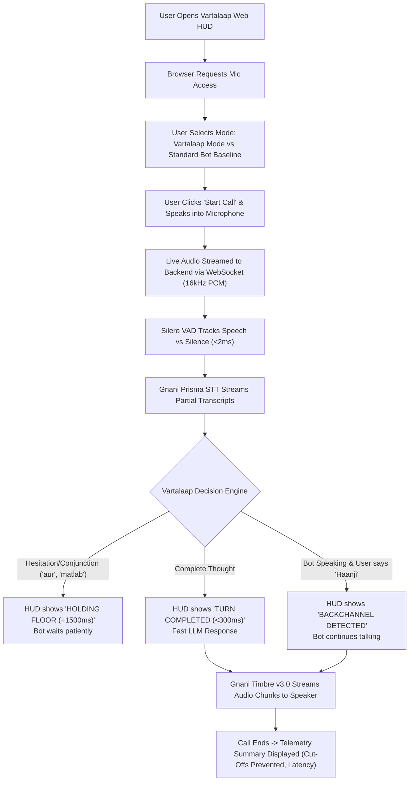

# 📄 1. Product Requirements Document (PRD) — Project Vartalaap

## 1. Problem Statement
Voice bots and conversational AI agents currently fail in the Indian market because they rely on rigid, Western-trained acoustic silence timeouts (typically 500ms to 800ms). When an Indian user speaks, three major failure modes occur constantly:
1. **Cognitive & Code-Mixing Cutoffs:** Bilingual and trilingual speakers frequently pause mid-sentence to switch languages or search for vocabulary (*"Mera account balance... [pause]... matlab ki savings account ka kitna hai?"*). Existing bots mistake this thinking pause for an end-of-turn and interrupt the user rudely.
2. **False Interruptions on Cultural Backchannels:** Indian conversations rely heavily on cooperative feedback tokens (*"haanji"*, *"achha"*, *"theek hai"*, *"seri"*, *"sare"*, *"avunu"*). When the bot is explaining something and the user says *"Haanji"*, standard barge-in systems treat it as a command, immediately cutting off the bot mid-speech.
3. **Sluggishness on Deterministic Confirmations:** When answering simple yes/no questions (*"Haan"*, *"Nahi"*, *"Confirm"*), waiting 800ms for a silence timer makes the bot feel sluggish, unnatural, and robotic.

**Who faces this?** Over 500 million Indian smartphone and telephonic voice bot users, and thousands of enterprises (banks, telecom, e-commerce, public services) experiencing high call drop-offs, low containment rates, and customer frustration.

---

## 2. Target Users
- **Primary Persona: "Ramesh" (Multilingual Indian Caller)**
  - **Age:** 28–55.
  - **Tech Comfort:** Moderate to Low. Comfortable with WhatsApp voice notes and UPI phone calls.
  - **Speech Pattern:** Natural code-mixing (Hinglish/Tanglish), uses frequent filler words (*"matlab"*, *"woh"*, *"ante"*) and cultural acknowledgments (*"haanji"*, *"achha"*).
  - **Pain Points:** Hates being interrupted by IVR/AI bots; frustrated when forced to speak rigid, textbook Hindi or English.
- **Secondary Persona: "Enterprise Product Manager / Voice Ops Lead"**
  - Needs high containment rates (>80%), low latency (<400ms), and zero brand erosion from glitchy voice bots.

---

## 3. Product Vision (North Star)
**"Vartalaap makes conversational voice AI listen with the patience, rhythm, and cultural intelligence of a native Indian listener."**

---

## 4. Core Features

| Feature ID | Feature Name | Description | Priority |
|---|---|---|---|
| **FEAT-01** | **Dynamic Silence Windowing** | Adapts silence threshold between 250ms and 2000ms based on syntactic completeness and hesitation cues. | **Must-Have** |
| **FEAT-02** | **Cultural Backchannel Gate** | Intercepts tokens like *"haanji"*, *"achha"*, *"seri"*, *"sare"*, *"hmm"* while bot is speaking, preventing false barge-in cutoffs. | **Must-Have** |
| **FEAT-03** | **Real-Time Streaming ASR via Gnani Prisma** | Bidirectional WebSocket integration for low-latency interim transcription and token streaming. | **Must-Have** |
| **FEAT-04** | **Expressive TTS via Gnani Timbre v3.0** | Synthesizes responses using inline emotional tags (`<excited>`, `<pauses>`, `<laugh>`) streamed back via WebSocket/SSE. | **Must-Have** |
| **FEAT-05** | **Real-Time Visual Telemetry HUD** | Interactive browser UI displaying live audio waveforms, dynamic timer gauges, and state badges (`HOLDING_FOR_THOUGHT`, `BACKCHANNEL_IGNORED`). | **Must-Have** |
| **FEAT-06** | **A/B Benchmark Comparison Mode** | Toggle between "Standard Voice Bot" (dumb 500ms timer) and "Vartalaap Smart Turn" on the fly to visibly demonstrate the difference. | **Must-Have** |
| **FEAT-07** | **Syntactic Completeness Classifier (RTX 5060)** | Fast local token evaluator (<10ms) checking for hanging conjunctions (*"aur"*, *"ki"*, *"lekin"*, *"and"*). | **Must-Have** |
| **FEAT-08** | **Telephony Audio Simulation (8kHz Bandwidth)** | Toggle to simulate real 8kHz telephone line noise and low bitrates to demonstrate robustness. | **Should-Have** |
| **FEAT-09** | **Turn-Taking Metrics Logger** | Records Premature Cut-Off Rate, False Barge-in Rate, and Latency into downloadable JSON/CSV reports. | **Should-Have** |
| **FEAT-10** | **Multi-Dialect Persona Switching** | Quick presets for Hindi/Hinglish, Tamil/Tanglish, and Telugu voice personas. | **Nice-to-Have** |

---

## 5. App Flow & User Journey

### Detailed Screen-by-Screen Flow:
1. **Landing & Initialization:**
   - Single-page application with dark theme, audio waveform visualizer, and live telemetry log.
   - User grants microphone permission.
   - Status badge shows: `CONNECTIVITY: READY (Gnani APIs Connected, RTX 5060 Active)`.
2. **Interactive Conversation:**
   - User clicks `Start Conversation` (or presses Spacebar).
   - As the user speaks, real-time waveform animates.
   - Subtitle box streams interim tokens: *"Mera account balance... matlab ki..."*
   - Status badge changes dynamically:
     - `LISTENING` (Green)
     - `THINKING_PAUSE_DETECTED: Extending timer to 1800ms` (Amber)
     - `TURN_GRANTED: Dispatching response` (Blue)
     - `BOT_SPEAKING` (Purple)
     - `BACKCHANNEL_IGNORED: User said 'haanji'` (Cyan)
3. **Comparison Toggle:**
   - User flips switch to **"Standard Bot Mode"**.
   - Speaking the exact same sentence causes the standard bot to cut them off immediately after *"balance..."*, proving Vartalaap's superiority.

---

## 6. Success Metrics & Key Performance Indicators (KPIs)
1. **Premature Cut-off Rate:**
   - Baseline Standard Bot: **~65%** on code-mixed sentences.
   - Vartalaap Target: **< 5%**.
2. **False Barge-in Rate on Backchannels:**
   - Baseline Standard Bot: **100%** (any sound over VAD threshold stops the bot).
   - Vartalaap Target: **< 5%** on catalogued backchannels (*"haanji"*, *"achha"*, *"seri"*).
3. **Turn Completion Latency:**
   - Under **350ms** for crisp, syntactically complete utterances.
4. **Hackathon Submission Goal:**
   - Deliver a working live demo, a public LinkedIn/X video showing the side-by-side comparison, and clean documentation before **Nov 10, 2026**.

---

## 7. What We Are Deliberately NOT Building in V1
- **No Complex User Authentication:** No multi-tenant user accounts, sign-ins, or passwords. Single-session demo ready for evaluation.
- **No Custom End-to-End ASR Training:** We rely on Gnani's pre-trained sovereign Prisma STT rather than training our own acoustic models from scratch.
- **No Complex Database Persistence:** Session logs and metrics will be kept in memory and optionally exported as JSON files; no heavy PostgreSQL/Supabase cluster needed.
- **No Hardware SIP/PBX Box Integration:** WebRTC / browser WebSocket audio handles the telephony simulation directly; no physical Asterisk/FreePBX servers required.
