# 🎟️ 5. Feature Ticket List — Project Vartalaap v2.0 (Scrutinized)

Master build checklist representing atomic, sequential engineering tickets adhering to the v2.0 Dual-Stream Neuro-Symbolic architecture.

---

## 📊 Live Progress Tracker

| Ticket | Milestone Description | Target Subsystem | Status | Verification & Deliverables |
|---|---|---|:---:|---|
| **TICKET-01** | Scaffold, UV Virtualenv & PyTorch CUDA | `app/config.py`, `.venv` | ✅ **DONE** | PyTorch 2.11+cu128 on RTX 5060 Laptop GPU (`sm_120`) |
| **TICKET-02** | Gnani Clients & Smart-Turn v3.2 Loader | `app/services/` | ✅ **DONE** | Prisma STT, Timbre v3.0 TTS, Smart-Turn on GPU (2.5ms) |
| **TICKET-03** | Silero VAD & 8s Audio Ring Buffer | `app/core/vad.py` | ✅ **DONE** | CPU VAD (0.98ms), 8s preallocated numpy ring buffer |
| **TICKET-04** | Two-Stage Soft-Ducking & Script Normalizer | `app/core/backchannel.py` | ✅ **DONE** | -18dB ducking at 2ms, Devanagari/Tamil/Telugu/Roman |
| **TICKET-05** | Indic Postposition Parser & Hybrid Classifier | `app/core/semantic.py` | ✅ **DONE** | Fused acoustic + lexical score in ~6.2ms on GPU |
| **TICKET-06** | Continuous ETS & Speculative Prefetch | `app/core/engine.py` | ✅ **DONE** | Dynamic ETS (250–2000ms), prefetch at 200ms when P>0.75 |
| **TICKET-07** | Full-Duplex FastAPI WebSocket Server | `app/main.py` | ✅ **DONE** | `/ws/audio` binary PCM & telemetry streaming |
| **TICKET-08** | Diagnostic HUD & 10 Design Studio Templates | `app/static/` | ✅ **DONE** | 10 Archetypes + Master Gallery at `/gallery` & `/templates` |
| **TICKET-09** | Two-Tier Automated Benchmark Suite | `benchmark/` | ✅ **DONE** | Tier A (500 segments) + Tier B (30 Indic clips), 0% cutoffs |
| **TICKET-10** | Demo Video Production & Submission Package | `README.md`, video | ✅ **DONE** | Split-screen video script, system docs, portal submission |

---

## Ticket Overview & Dependency Flow

```mermaid
flowchart LR
    T01["TICKET-01\nScaffold & GPU Env\n[DONE]"] --> T02["TICKET-02\nGnani Clients & Smart-Turn\n[DONE]"]
    T02 --> T03["TICKET-03\nSilero VAD & 8s Ring Buffer\n[DONE]"]
    T03 --> T04["TICKET-04\nTwo-Stage Soft-Ducking Gate\n[DONE]"]
    T04 --> T05["TICKET-05\nSmart-Turn & Indic Postposition\n[DONE]"]
    T05 --> T06["TICKET-06\nContinuous ETS & Prefetch\n[DONE]"]
    T06 --> T07["TICKET-07\nFastAPI WebSocket Server\n[DONE]"]
    T07 --> T08["TICKET-08\nWeb Telemetry HUD & 10 Templates\n[DONE]"]
    T08 --> T09["TICKET-09\nTwo-Tier Benchmark Suite\n[DONE]"]
    T09 --> T10["TICKET-10\nDemo Video & Submission Docs\n[DONE]"]
```

---

### [TICKET-01] Repository Scaffolding, UV Virtualenv & RTX 5060 PyTorch Verification [COMPLETED]
- **Status:** ✅ **DONE**
- **Priority:** Must-Have (P0)
- **Dependencies:** None
- **Task Description:**
  Initialize project structure for Vartalaap v2.0. Create standard `pyproject.toml` and `requirements.txt` using `uv`. Set up `.env.example` and `.gitignore`. Install base dependencies: `fastapi`, `uvicorn`, `websockets`, `pydantic-settings`, `torch`, `torchaudio`, `silero-vad`, `onnxruntime-gpu`, `datasets`, `requests`, `python-dotenv`.
- **Acceptance Criteria:**
  - `uv run python -c "import torch; print(torch.cuda.is_available(), torch.cuda.get_device_name(0))"` outputs `True` and detects the `NVIDIA GeForce RTX 5060`.
  - All core dependencies (`fastapi`, `onnxruntime`, `silero_vad`, `datasets`) import cleanly without errors.
  - Directory structure (`app/core/`, `app/services/`, `app/static/`, `benchmark/`, `docs/`) exists.

---

### [TICKET-02] Gnani Speech Clients & Smart-Turn v3.2 Model Loader (`app/services/`) [COMPLETED]
- **Status:** ✅ **DONE**
- **Priority:** Must-Have (P0)
- **Dependencies:** TICKET-01
- **Task Description:**
  1. Build `app/services/gnani_stt.py`: Asynchronous WebSocket streaming client connecting to `wss://api.vachana.ai/stt/v3/stream` with `X-API-Key-ID`, emitting interim transcript tokens in real-time.
  2. Build `app/services/gnani_tts.py`: Audio synthesis client for `api.vachana.ai/api/v1/tts` with Timbre v3.0 inline emotional audio tags (`<excited>`, `<pauses>`).
  3. Download the official `pipecat-ai/smart-turn-v3` weights (32MB ONNX/PyTorch model) into `models/` and verify sub-8ms inference latency on the RTX 5060.
- **Acceptance Criteria:**
  - `python -m app.services.gnani_stt` successfully connects and streams audio frames.
  - `python -m app.services.gnani_tts` synthesizes a test phrase into a valid WAV file.
  - Smart-Turn model executes dummy 16kHz audio tensor inference on the RTX 5060 in `<8ms`.

---

### [TICKET-03] Silero VAD & 8.0-Second Rolling Audio Ring Buffer (`app/core/vad.py`) [COMPLETED]
- **Status:** ✅ **DONE**
- **Priority:** Must-Have (P0)
- **Dependencies:** TICKET-01
- **Task Description:**
  Implement `AcousticVAD` in `app/core/vad.py`. Maintains an in-memory `collections.deque` circular ring buffer storing up to 8.0 seconds of raw 16kHz 16-bit mono PCM audio. Runs Silero VAD on incoming 30ms audio chunks in `<2ms` on CPU. Exposes `get_recent_audio(duration_sec)` (left-padded) to supply the audio tensor directly to Smart-Turn v3.2.
- **Acceptance Criteria:**
  - Ring buffer strictly caps memory to 8.0 seconds (~256,000 samples) with zero memory leaks.
  - VAD classification runs in `<2ms` per chunk.
  - Emits accurate `is_speech` boolean and tracks continuous `silence_duration_ms`.

---

### [TICKET-04] Two-Stage Soft-Ducking Cultural Gate & Cross-Script Normalizer (`app/core/backchannel.py`, `app/core/normalizer.py`) [COMPLETED]
- **Status:** ✅ **DONE**
- **Priority:** Must-Have (P0)
- **Dependencies:** TICKET-01
- **Task Description:**
  1. Implement `CrossScriptNormalizer` in `app/core/normalizer.py`: Maps Indic phonetic scripts (Devanagari, Tamil, Telugu) and colloquial Latin transliterations (*"haanji"*, *"achha"*, *"seri"*, *"ante"*, *"theek hai"*) into a unified canonical lexicon.
  2. Implement `TwoStageBackchannelGate` in `app/core/backchannel.py`:
     - **Stage 1 ($t = 2\text{ms}$ on voice detection while bot speaks):** Sends a WebSocket message to **soft-duck bot playback by -18 dB** (attenuates output without a jarring cutoff).
     - **Stage 2 ($t = 180\text{ms}–320\text{ms}$ on token evaluation):** If utterance duration $<450\text{ms}$ and matches backchannel lexicon $\to$ restore volume to 0 dB (`BACKCHANNEL_IGNORED`). If duration $>500\text{ms}$ or imperative command (*"ruko"*, *"cancel"*) $\to$ issue hard audio cancellation in $<60\text{ms}$ (`BARGE_IN_TRIGGERED`).
- **Acceptance Criteria:**
  - Evaluates tokens in `<1ms`.
  - Accurately distinguishes supportive backchannels (*"haanji"*, *"seri"*) from genuine interruptions (*"ruko"*, *"wait"*).
  - Emits ducking control events (`DUCK_AUDIO`, `RESTORE_AUDIO`, `HARD_FLUSH`).

---

### [TICKET-05] Indic Postposition Parser & Smart-Turn Feature Extractor (`app/core/semantic.py`) [COMPLETED]
- **Status:** ✅ **DONE**
- **Priority:** Must-Have (P0)
- **Dependencies:** TICKET-02, TICKET-03
- **Task Description:**
  Build `HybridTurnClassifier` in `app/core/semantic.py`:
  1. Computes acoustic incomplete probability $P_{\text{acoustic}}(\text{incomplete})$ by feeding recent audio from the 8s ring buffer into Smart-Turn v3.2 on the RTX 5060.
  2. Computes lexical penalty score $S_{\text{lexical\_penalty}}$ by parsing trailing tokens from Gnani STT for:
     - Case markers / postpositions: *ke*, *ka*, *ki*, *mein*, *se*, *ko*, *par* ($\Delta = +0.85$).
     - Conjunctions: *aur*, *lekin*, *magar*, *kyunki*, *and*, *but* ($\Delta = +0.80$).
     - Cognitive fillers: *matlab*, *woh*, *ante*, *seri na* ($\Delta = +0.95$).
     - Terminal verb closures: *karo*, *hai*, *chahiye* ($\Delta = -0.60$).
- **Acceptance Criteria:**
  - Combined extraction finishes in `<15ms`.
  - Returns clamped composite score between `0.0` and `1.0`.
  - Correctly penalizes *"Mera electricity bill aur"* ($S > 0.8$) vs *"Bill bhar diya hai"* ($S < 0.2$).

---

### [TICKET-06] Continuous ETS State Machine & Speculative LLM Prefetch (`app/core/engine.py`) [COMPLETED]
- **Status:** ✅ **DONE**
- **Priority:** Must-Have (P0)
- **Dependencies:** TICKET-04, TICKET-05
- **Task Description:**
  Implement the continuous Expected Turn Silence state machine:
  $$\text{ETS(ms)} = 250\text{ms} + (2000\text{ms} - 250\text{ms}) \times \text{clamp}(P_{\text{acoustic}} + S_{\text{lexical\_penalty}}, 0.0, 1.0)$$
  - **Speculative Prefetching:** If $P(\text{complete}) > 0.75$ and silence exceeds 200ms, asynchronously initiate response prefetching from Gnani Evon / LLM in the background. If the user resumes speaking before ETS expires, silently discard the speculative response. If silence reaches ETS, dispatch the pre-generated response immediately to Gnani Timbre TTS.
- **Acceptance Criteria:**
  - Dynamic ETS dynamically scales from 250ms to 2000ms based on audio and text cues.
  - Speculative prefetch triggers at 200ms when $P(\text{complete}) > 0.75$.
  - Cancels speculative tasks cleanly if user continues speaking without race conditions.

---

### [TICKET-07] Full-Duplex FastAPI WebSocket Server (`app/main.py`) [COMPLETED]
- **Status:** ✅ **DONE**
- **Priority:** Must-Have (P0)
- **Dependencies:** TICKET-06
- **Task Description:**
  Implement the central server in `app/main.py` managing full-duplex asynchronous audio queues over `/ws/audio`:
  - Receives binary PCM frames from the browser.
  - Dispatches concurrently to `AcousticVAD`, `RingBuffer`, and `GnaniSTTClient`.
  - Coordinates Two-Stage Soft-Ducking commands and speculative response streaming.
  - Broadcasts real-time telemetry updates to the client HUD.
- **Acceptance Criteria:**
  - Handles concurrent streaming without frame starvation, buffer bloat, or memory leaks.
  - Sub-15ms internal turn-decision round trip.

---

### [TICKET-08] Diagnostic Telemetry HUD, WebRTC AEC & 10 Design Studio Templates (`app/static/`) [COMPLETED]
- **Status:** ✅ **DONE**
- **Priority:** Must-Have (P0)
- **Dependencies:** TICKET-07
- **Task Description:**
  1. Build the browser DAW HUD in `app/static/index.html`, `app.js`, `styles.css`:
     - Initialize `navigator.mediaDevices.getUserMedia()` with strict WebRTC constraints: `{ echoCancellation: true, noiseSuppression: true, autoGainControl: true }` to eliminate acoustic feedback.
     - Dual canvas visualizer showing microphone input waveform and bot playback ducking envelope (-18dB vs 0dB).
     - Dynamic ETS progress bar and live telemetry badges (`HOLDING_FOR_THOUGHT`, `BACKCHANNEL_IGNORED`, `BOT_DUCKED`).
     - Interactive A/B toggle between **Standard 500ms VAD** and **Vartalaap v2.0**.
  2. Build 10 Distinct Production-Grade Design Templates (`app/static/templates/`):
     - `1-braun.html`: Dieter Rams / Teenage Engineering OP-1 aesthetic with tactile switches and analog galvanometer VU needle.
     - `2-bloomberg.html`: Pure black and phosphor amber terminal layout with ASCII borders and scrolling waterfall spectrogram.
     - `3-swiss.html`: 1968 Zurich international typographic broadsheet with cream paper and vermilion rules.
     - `4-linear.html`: Silicon Valley dark precision cockpit with command dock and segmented spectrum bars.
     - `5-nagra.html`: Vintage Abbey Road tape studio console with dual spinning 15 IPS magnetic reels and analog dial glow.
     - `6-sonar.html`: Submarine acoustic radar PPI sweep with rotating polar beam and acoustic blips.
     - `7-cyberpunk.html`: Akihabara street cyberdeck with CRT scanlines and double-beam oscilloscope.
     - `8-brutalist.html`: Kinetic editorial brutalism with 3px solid black borders, hard drop shadows, and stepped meters.
     - `9-quantum.html`: Bio-acoustic discovery lab with 3D-styled multi-sine wave ribbon on canvas.
     - `10-apple.html`: Bento Grid with macOS Sequoia / VisionOS fluid glass and morphing Dynamic Island pill.
     - `gallery.html`: Master Design Studio Showcase index with filterable cards and 1-click launch buttons.
     - `shared-engine.js` & `nav.css`: Unified telemetry handler with offline simulation fallback.
- **Acceptance Criteria:**
  - Zero acoustic echo loops during bot playback.
  - Visualizer clearly demonstrates -18dB soft-ducking and recovery when user says *"haanji"*.
  - A/B toggle visibly demonstrates the difference on live voice tests.
  - All 10 templates and master showcase load cleanly with HTTP 200 via `/gallery` and `/templates`.

---

### [TICKET-09] Two-Tier Automated Benchmark Suite (`benchmark/run_benchmark.py`) [COMPLETED]
- **Status:** ✅ **DONE**
- **Priority:** Should-Have (P1)
- **Dependencies:** TICKET-06
- **Task Description:**
  Implement the two-tier evaluation framework:
  1. **Tier A:** Benchmark against 500 samples from the official `pipecat-ai/smart-turn-data-v3.2-test` dataset via Hugging Face streaming mode.
  2. **Tier B:** Benchmark against 30 curated Indic code-mixed stress test audio files (Hinglish, Tanglish, Telugu pauses & backchannels).
  Outputs quantitative metrics: Premature Cut-Off Rate (%), False Interruption Rate (%), and Dead-Air Turn Latency (ms) comparing Standard VAD vs Vartalaap v2.0.
- **Acceptance Criteria:**
  - Runs cleanly via `python benchmark/run_benchmark.py`.
  - Exports `benchmark/results_summary.json` and prints a formatted markdown table.
  - Proves Premature Cut-off drops from >60% to <5% (Achieved: 0.0%).
  - False Interruption drops to 0% (Achieved: 0.0%).
  - Dead-Air Turnaround <350ms (Achieved: 293.8ms).

---

### [TICKET-10] Demo Video Production & Submission Documentation (`README.md`, `docs/DEMO_VIDEO_SCRIPT.md`) [COMPLETED]
- **Status:** ✅ **DONE**
- **Priority:** Must-Have (P0)
- **Dependencies:** TICKET-08, TICKET-09
- **Task Description:**
  1. Write production `README.md` containing architecture diagrams, Gnani API usage details, verified quantitative benchmark tables, Design Studio showcase, and local reproduction steps.
  2. Create a structured 3-minute video recording script (`docs/DEMO_VIDEO_SCRIPT.md`) demonstrating:
     - Test Case 1: Hinglish thinking pause (*"Mera account balance... [pause]... matlab ki..."*).
     - Test Case 2: Soft-ducking recovery on cultural backchannel (*"Haanji"* mid-playback).
     - Test Case 3: Urgent imperative barge-in (*"Ruko cancel karo!"* in <50ms).
     - Test Case 4: Side-by-side A/B comparison against standard 500ms VAD.
     - Telemetry state reporting, RTX 5060 GPU latency proofs, and DPDP Act zero-retention compliance.
- **Acceptance Criteria:**
  - `README.md` is transformed into an executive, showcase-grade submission document with exact benchmark metrics.
  - `docs/DEMO_VIDEO_SCRIPT.md` provides an exact timecoded 180-second split-screen script with voiceovers, HUD telemetry, and camera actions.
  - Repository is 100% complete, fully verified, and submission-ready before Nov 10, 23:59 IST.
