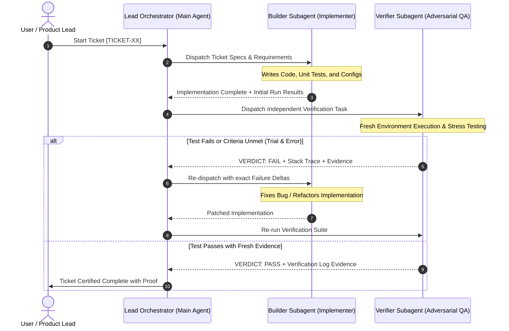

# 🤖 Multi-Agent Implementation & Verification Suite — Vartalaap

## 1. Operating Paradigm: Dual-Agent Adversarial Loop

To ensure zero hallucinated success, production-grade code quality, and strict adherence to the [Feature Ticket List](file:///c:/Antigravity%20Dev/Gnani%20Hackathon/docs/5_FEATURE_TICKETS.md), Vartalaap is executed using a **Dual-Agent Adversarial Feedback Loop**:



---

## 2. Agent Roles & Contracts

### A. The Lead Orchestrator (Main Agent)
- **Role:** Project Manager & Stage Gatekeeper.
- **Responsibilities:**
  - Maintains the global ticket state (`TODO` $\rightarrow$ `IN_PROGRESS` $\rightarrow$ `VERIFIED` $\rightarrow$ `CLOSED`).
  - Dispatches tasks to the Builder and Verifier subagents.
  - Ensures no ticket proceeds to the next phase without a signed **`VERDICT: PASS`** from the Verifier.

### B. The Builder Subagent (`Role: Lead Systems Implementer`)
- **Role:** Pure execution and code construction.
- **Directives:**
  - Writes modular, type-hinted Python/JavaScript code according to the [Technical Architecture](file:///c:/Antigravity%20Dev/Gnani%20Hackathon/docs/2_TECHNICAL_ARCHITECTURE.md).
  - Creates accompanying unit tests / smoke tests for every file touched.
  - Never marks a ticket complete; only presents work for review.

### C. The Verifier Subagent (`Role: Adversarial QA & Spec Auditor`)
- **Role:** Independent validation and regression testing.
- **The Iron Law:** `NO COMPLETION CLAIMS WITHOUT FRESH VERIFICATION EVIDENCE`.
- **Directives:**
  - Executes commands freshly using the shell (checks exit codes, stderr, memory usage, GPU detection).
  - Tests negative cases: What happens if audio is silent? What if an invalid API key is passed? What if an unknown Hinglish filler appears?
  - Outputs a standardized verdict block:
    ```markdown
    ### 🛡️ VERIFICATION REPORT: [TICKET-ID]
    - Status: [PASS | FAIL]
    - Acceptance Criteria Checked: [X/Y Passed]
    - Command Executed: `<exact command>`
    - Execution Evidence: `<terminal stdout/stderr snapshot>`
    - Adversarial / Edge Case Test: `<result>`
    - Delta Required (if FAIL): `<clear technical instructions for Builder>`
    ```

---

## 3. The 10-Ticket Execution Sequence

Each ticket will follow the Builder $\rightarrow$ Verifier $\rightarrow$ Healer loop:

| Stage | Ticket ID | Scope | Verification Gate |
|---|---|---|---|
| **Phase 1** | **TICKET-01** | UV environment, pyproject.toml, PyTorch CUDA GPU test | Verifier confirms `torch.cuda.is_available() == True` on RTX 5060 & all imports pass. |
| | **TICKET-02** | Gnani STT & TTS Client Wrappers (`app/services/gnani_client.py`) | Verifier runs live handshake script testing STT & TTS with dummy audio. |
| **Phase 2** | **TICKET-03** | Silero VAD Audio Frame Classifier (`app/core/vad.py`) | Verifier tests VAD latency (<3ms per chunk) on silence vs. speech audio. |
| | **TICKET-04** | Cultural Backchannel Gate & Lexicons (`app/core/backchannel.py`) | Verifier runs unit tests on Hindi/Tamil/Telugu backchannels with 100% precision. |
| | **TICKET-05** | Indic Syntactic Completeness Evaluator (`app/core/semantic.py`) | Verifier checks classification accuracy on hanging conjunctions (*aur*, *ki*, *matlab*). |
| | **TICKET-06** | Dynamic Turn State Machine (`app/core/state_machine.py`) | Verifier verifies dynamic timer scaling (250ms to 2000ms) under simulated pauses. |
| **Phase 3** | **TICKET-07** | FastAPI Server & WebSocket Pipeline (`app/main.py`) | Verifier tests bi-directional WebSocket audio frame streaming and JSON telemetry. |
| | **TICKET-08** | Browser Telemetry HUD Frontend (`app/static/`) | Verifier tests web UI serving, audio capture initialization, and canvas visualizer. |
| **Phase 4** | **TICKET-09** | Automated A/B Benchmark Suite (`benchmark/run_benchmark.py`) | Verifier confirms automated comparison table runs and generates benchmark metrics. |
| | **TICKET-10** | Demo Video Script & Hackathon Submission Docs | Verifier inspects `README.md` completeness, demo instructions, and code cleanliness. |

---

## 4. Healing & Recovery Rules
1. **Max Healing Loops:** If a ticket fails verification, the Builder is given the exact error trace and 3 retry attempts. If unresolved, the Orchestrator pauses and alerts the user with diagnostics.
2. **Atomic Git Commits:** After a ticket receives `VERDICT: PASS`, the working state is committed (`git commit -m "feat(core): complete [TICKET-XX] ..."`), guaranteeing a rollback point.
