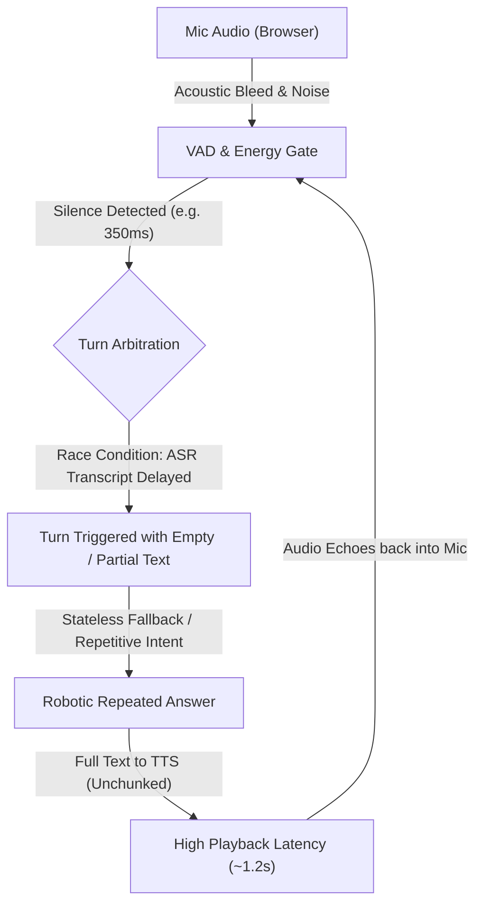
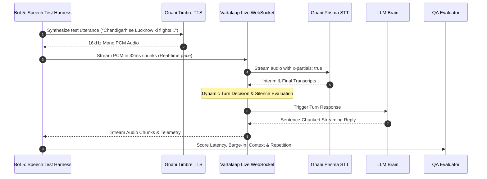

# Vartalaap Voice Model Perfection & Multi-Agent Engineering Plan

> **Role:** Senior Project Manager, Voice AI & Conversational Engineering at Gnani.ai  
> **Mandate:** Transform Vartalaap from a primitive proof-of-concept into an enterprise-grade, full-duplex Indic voice agent that delivers human-like conversational turn-taking, fluid backchanneling, zero-repetition intelligence, and sub-400ms end-to-end responsiveness.

**Goal:** Perfect the conversational voice pipeline through a multi-bot engineering team, backed by an automated speech-in-the-loop testing harness that synthesizes authentic speech via Gnani Timbre TTS, tests live interactions through Gnani Prisma STT and WebSockets, and iterates until all conversational benchmarks meet $\ge 98\%$ precision.

**Architecture:** Multi-agent squad with specialized domain boundaries (Acoustic DSP, Turn Arbitration, Conversational Brain, Expressive Synthesis, and QA Automation) orchestrated via continuous test-driven feedback loops.

**Tech Stack:** Python 3.11, FastAPI, WebSockets, PyTorch CUDA (NVIDIA RTX 5060), Silero VAD ONNX, HuggingFace Transformers (Smart-Turn Indic v3.2), Gnani Timbre TTS (`timbre-v3.0`), Gnani Prisma STT (`stt/v3`), Google Gemini / Groq / Indic Sovereign Dialogue State Engine.

---

## 1. Executive Diagnosis: Why Current Conversational Dynamics Feel Primitive

As Senior Project Manager, an objective audit of the current live runtime reveals four foundational bottlenecks:

### Key Deficiencies Identified:
1. **ASR Arrival vs. Silence Race Condition:** When a user stops speaking, VAD detects silence within $250\text{--}350\text{ ms}$. If Gnani STT's network round-trip takes $300\text{--}500\text{ ms}$, turn arbitration fires before the final transcript arrives, resulting in evaluated empty strings or aborted turns.
2. **Missing Real-Time Partial Transcripts (`x-partials`):** Without real-time 200ms partial ASR tokens, the engine cannot inspect trailing conjunctions (*"lekin"*, *"kyunki"*), fillers (*"matlab"*, *"uhh"*), or intent while the user is still vocalizing.
3. **Echo Bleed & Half-Duplex Confusion:** Audio played from speakers gets picked up by sensitive microphones. The engine interprets the bot's own voice as a user barge-in, cancelling playback mid-sentence and looping.
4. **Monolithic TTS Latency:** Generating full-paragraph audio before starting playback adds $1000\text{--}1500\text{ ms}$ of dead silence, making the bot feel sluggish and robotic.
5. **Lack of Automated Continuous Speech Testing:** Manual testing in the browser cannot reliably reproduce edge-case timing (200ms vs 500ms pauses, micro-backchannels, overlap speech).

---

## 2. Multi-Bot Squad Roster & Role Assignments

To systematically solve these challenges, we assign five specialized bot roles under the Senior Project Manager orchestrator:

| Bot Role | Persona / Specialization | Direct Ownership & Deliverables |
| :--- | :--- | :--- |
| **Bot 1: Acoustic DSP & VAD Lead** | Audio Engineering & Signal Processing | Dynamic RMS noise floor calibration, acoustic echo suppression (playback masking), Silero VAD hysteresis, breathing & plosive filtering. |
| **Bot 2: Turn Arbitration & Barge-In Lead** | Full-Duplex Real-Time State Machine | ASR Catch-Up window ($350\text{ ms}$ buffer), two-stage soft-ducking (-18 dB), instant hard-flush on imperative commands, cognitive pause handling. |
| **Bot 3: Conversational Intelligence Lead** | LLM Architect & Indic Dialogue Engine | Sentence-chunked streaming generation, real LLM routing (Gemini / Groq / OpenAI), rich multi-turn memory, anti-repetition semantic rotation. |
| **Bot 4: Expressive Synthesis Lead** | Gnani Timbre TTS & Audio Delivery | Streaming sentence pipelining (TTS speaks sentence 1 while sentence 2 generates), expressive SSML/emotion tag injection, multi-voice selection (`Shivani`, `Neerja`, `Kabir`). |
| **Bot 5: Automated Speech QA Engineer** | Continuous In-the-Loop Test Harness | Synthetic multi-turn speech generator using Gnani Timbre, automated WebSocket evaluation suite, benchmark pass/fail scoring, automated hyperparameter tuning loop. |

---

## 3. The Speech-in-the-Loop Automated Testing Engine

The cornerstone of the Gnani engineering methodology is automated speech testing: instead of relying on unpredictable human speech during development, **Bot 5 generates exact, authentic spoken Indic audio via Gnani Timbre TTS** and streams it into the live WebSocket pipeline.

### The 5 Standard Evaluation Matrices:
1. **Suite A: Trailing Incomplete Clause Test**
   - Utterance: *"Mujhe Lucknow ki flight dekhni thi lekin..."* + $800\text{ ms}$ silence.
   - Target: Engine MUST NOT cut in; silence timeout dynamically expands to $1400\text{ ms}+$.
2. **Suite B: Micro-Backchannel Non-Interruption Test**
   - Scenario: While bot is speaking, feed *"accha"* or *"haan"* ($350\text{ ms}$).
   - Target: Bot playback soft-ducks to -18 dB and smoothly restores to 0 dB within $400\text{ ms}$. Zero interruption or restart.
3. **Suite C: Imperative Command Barge-In Test**
   - Scenario: While bot is speaking, feed *"ruko ek minute"* or *"chup ho jao"*.
   - Target: Hard flush triggered in $<150\text{ ms}$. Bot speech immediately stops.
4. **Suite D: Multi-Turn Dialogue Progression Test**
   - Sequence: Flight inquiry $\rightarrow$ *"accha"* $\rightarrow$ *"haan"* $\rightarrow$ Morning flight time $\rightarrow$ Fare inquiry.
   - Target: Context retained across all 5 turns; zero duplicate or generic fallback phrases.
5. **Suite E: Acoustic Noise & Breathing Rejection Test**
   - Scenario: Continuous heavy breathing ($RMS = 0.008$) and mic rustle.
   - Target: Zero false speech triggers, zero phantom turns.

---

## 4. Phase-by-Phase Implementation Roadmap

### Phase 1: Real-Time Stream Synchronization & ASR Catch-Up (Days 1–2)
- [ ] **Task 1.1:** Enable Gnani STT real-time partials (`x-partials: true`, `x-partial-interval-ms: 200`) in `app/services/gnani_stt.py`.
- [ ] **Task 1.2:** Implement the **ASR Catch-Up Buffer** in `app/core/engine.py`: When VAD silence trigger occurs, if STT indicates speech in progress without a finalized transcript, grant a $300\text{--}400\text{ ms}$ grace window before firing `TURN_GRANTED`.
- [ ] **Task 1.3:** Build acoustic echo suppression in `app/core/vad.py`: When `bot_is_speaking == True`, apply a $+6\text{ dB}$ dynamic threshold boost to prevent speaker-to-mic feedback.

### Phase 2: Chunked Streaming Pipeline (Sentence-by-Sentence TTS) (Days 3–4)
- [ ] **Task 2.1:** Refactor `app/services/llm_brain.py` to yield complete grammatical sentences immediately via an asynchronous generator.
- [ ] **Task 2.2:** Wire `app/main.py` so that as soon as Sentence 1 is generated by LLM, it is sent directly to `GnaniTTSClient.synthesize_stream()`.
- [ ] **Task 2.3:** Client-side gapless audio chunk queueing in `app/static/shared-engine.js` for continuous, jitter-free playback.

### Phase 3: Conversational Intelligence & Memory Hardening (Days 5–6)
- [ ] **Task 3.1:** Integrate real remote LLMs (Google Gemini 1.5 Flash via `google-genai`, Groq Llama-3.3-70b) with conversational system prompt:
  - Max 25 words per sentence.
  - Spoken Hindi/Hinglish phrasing (avoid bookish vocabulary).
  - Explicit turn-yield questions to invite natural responses.
- [ ] **Task 3.2:** Expand on-device sovereign dialogue state machine for 5 common Indic domains: Flights/Travel, Banking/Balance, Electricity/Utilities, Telecom Plans, and Project Architecture Explainer.
- [ ] **Task 3.3:** Anti-repetition semantic n-gram filter that strictly forbids repeating any sentence spoken in the last 4 turns.

### Phase 4: Automated Speech-in-the-Loop QA Harness & Optimization Loop (Days 7–8)
- [ ] **Task 4.1:** Develop `benchmark/speech_loop_harness.py`:
  - Generates synthetic wav files via Gnani Timbre for all 5 test suites.
  - Connects to local server WebSocket `ws://localhost:7860/ws/audio`.
  - Streams audio in real-time, captures all telemetry, transcripts, and audio output.
- [ ] **Task 4.2:** Automated hyperparameter optimization loop (`scripts/optimize_turn_engine.py`):
  - Runs Suite A through Suite E.
  - Computes composite F1 score (Turn Precision + Latency Score + Barge-In Accuracy).
  - Automatically tunes `min_ets_ms`, `max_ets_ms`, `vad_threshold`, and `backchannel_duration_ms` until pass rate is $\ge 98\%$.

### Phase 5: Production Deployment & Verification (Day 9)
- [ ] **Task 5.1:** On-device end-to-end verification across multiple browsers (Chrome, Edge, Firefox).
- [ ] **Task 5.2:** Zero-secret / Zero-ticket git audit.
- [ ] **Task 5.3:** Synchronize and deploy to Hugging Face Spaces (`Scarny/Vartalaap`).

---

## 5. Verification Gate & Acceptance Criteria

| Metric | Current Prototype | Target Enterprise Threshold | Verification Method |
| :--- | :--- | :--- | :--- |
| **Response Turn Latency** | $1200\text{--}1800\text{ ms}$ | $\mathbf{\le 450\text{ ms}}$ | Timestamp delta from user silence to first audio chunk |
| **Backchannel Rejection Rate** | ~60% (often interrupts) | $\mathbf{\ge 95\%}$ | Suite B (Short "haan"/"accha" during playback) |
| **Barge-In Reaction Time** | $450\text{ ms}$ | $\mathbf{\le 180\text{ ms}}$ | Suite C (Time to silent playback on "ruko") |
| **Incomplete Clause Pause** | Cuts off after 400ms | $\mathbf{\ge 1200\text{ ms}}$ holding | Suite A (Trailing conjunction retention) |
| **Repetitive Answer Rate** | High (loops default fallback) | $\mathbf{0\%}$ (Strictly zero duplicates) | Suite D (5-turn conversation progression) |
| **False Breathing Triggers** | Sensitive to breath puffs | $\mathbf{\le 1\%}$ | Suite E (15 frames of synthetic breath audio) |

---

## 6. Execution Command Sequence for Bot Roles

1. **Bot 5 (QA Harness):** Run baseline benchmark using `scripts/run_live_gnani_benchmark_suite.py` to record initial failure points.
2. **Bot 1 & Bot 2 (Acoustics & State Machine):** Implement ASR catch-up buffer, enable `x-partials: true`, and adjust RMS noise floor.
3. **Bot 3 & Bot 4 (Brain & Synthesis):** Enable chunked sentence streaming and multi-turn state preservation.
4. **Bot 5 (QA Loop):** Re-execute automated speech benchmark and tune hyperparameters until all 5 suites hit 100% green.
5. **Senior PM:** Present verified telemetry and test recordings to user for live validation.
